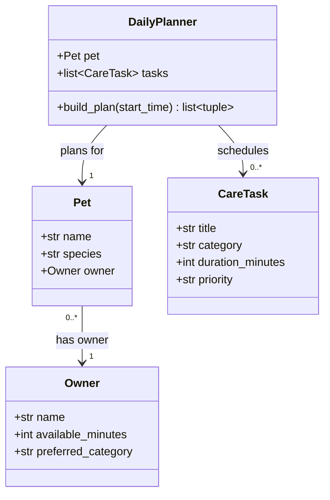

f# PawPal+ (Module 2 Project)

You are building **PawPal+**, a Streamlit app that helps a pet owner plan care tasks for their pet.

## Scenario

A busy pet owner needs help staying consistent with pet care. They want an assistant that can:

- Track pet care tasks (walks, feeding, meds, enrichment, grooming, etc.)
- Consider constraints (time available, priority, owner preferences)
- Produce a daily plan and explain why it chose that plan

Your job is to design the system first (UML), then implement the logic in Python, then connect it to the Streamlit UI.

## Implementation summary

The multi-pet backend models each care activity as a `Task` with a duration,
frequency label, priority, and completion status. Each `Pet` holds its tasks,
while an `Owner` holds multiple pets and gathers their tasks through
`get_all_tasks()`. The `Scheduler` uses that combined list to plan incomplete
tasks within the owner's available time and explain its choices.

The terminal demo and Streamlit app both use this backend. In the app, add
pets, select a pet to add or edit its tasks, and generate a shared daily plan.

## Initial class design



This initial draft describes the earlier single-pet planner in `pawpal.py`;
the current multi-pet backend reverses the owner-pet relationship and is
described below.

## Planning rules

Tasks are sorted by priority (high, medium, low), then by the owner's preferred
category within the same priority, preserving entry order for ties. The planner
greedily schedules tasks that fit within the available minutes and by
midnight, skipping tasks that do not fit and continuing to consider the rest.
Scheduled tasks are placed consecutively from the chosen start time; these
times are suggestions, not medication instructions or fixed appointments.
The app shows its reasoning and lists unscheduled tasks. Tasks and inputs live
in the Streamlit session and are not saved after that session ends.

Use Python 3.10 or later. Run the app with `streamlit run app.py` and the tests
with `pytest`.

## Multi-pet backend

`pawpal_system.py` contains the multi-pet implementation: an `Owner`
holds pets, each `Pet` holds tasks, and `Owner.get_all_tasks()` returns
`(pet, task)` pairs for the `Scheduler`. The scheduler considers incomplete
tasks across all pets, using the same priority, preference, time-budget, and
midnight rules described above. It returns each pet and task with suggested
start/end times and a reason; tasks that do not fit have `None` for both times.

The Streamlit app stores the owner and its pets and tasks in session state.
Tasks can be marked complete when edited; completed tasks are excluded from
plans. The due date is visible and editable for each task.

## Smarter Scheduling

- **Sorting — `Scheduler.sort_by_time()`:** Returns all `(pet, task)` pairs,
  including completed tasks, from shortest to longest duration. This does not
  change the priority-first ordering used by `Scheduler.build_plan()`.
- **Filtering — `Scheduler.filter_tasks()`:** Filters pet-task pairs by
  completion status, pet name, or both. Names are trimmed and matched exactly
  without regard to case; duplicate names match all corresponding pets.
- **Conflict detection — `Scheduler.detect_conflicts()`:** Returns warnings
  for overlapping intervals across the same or different pets, and for
  invalid or incomparable intervals. Adjacent intervals are not conflicts and
  unscheduled entries are ignored. Generated plans are consecutive, so the
  method is also useful for checking supplied intervals.
- **Recurring tasks — `Task.mark_complete()` and `Task.mark_incomplete()`:**
  Completing a daily or weekly task creates an incomplete occurrence due one
  or seven days after completion. Frequency matching is case-insensitive; other
  labels do not recur automatically. Reopening removes the next occurrence
  only if it is unchanged and incomplete. `Scheduler.build_plan()` excludes
  future occurrences until they are due.

Task time is a duration in minutes; tasks do not have fixed start times.
Suggested times are not medication instructions or fixed appointments; follow
veterinary advice for time-sensitive care.

Run `python main.py` for a terminal demonstration of the multi-pet scheduler.

## Sample Output

```text
Tasks sorted by duration (including completed tasks)
5 min | Luna: Grooming
10 min | Mochi: Breakfast
15 min | Luna: Playtime
25 min | Mochi: Morning walk

Incomplete tasks for Luna
Luna: Playtime

Completed tasks
Luna: Grooming

Today's Schedule
09:00-09:25 | Mochi: Morning walk (25 min)
  High priority; matches your preferred category; fits in the remaining 60 minutes.
09:25-09:35 | Mochi: Breakfast (10 min)
  High priority; fits in the remaining 35 minutes.
09:35-09:50 | Luna: Playtime (15 min)
  Medium priority; fits in the remaining 25 minutes.

Conflict detection example (manually overlapping times)
Warning: Schedule conflict: Mochi: Morning walk overlaps Luna: Playtime.
```

## Testing PawPal+

Run the test suite from the project directory:

```bash
python -m pytest
```

The tests cover task completion and addition, multi-pet scheduling, sorting,
filtering, recurrence, conflict warnings, input validation, and Streamlit
interactions. A successful run produced:

```text
============================= test session starts ==============================
platform darwin -- Python 3.14.3, pytest-9.2.0, pluggy-1.7.0
rootdir: /Users/imanimusembi/ai110-module2show-pawpal-starter
plugins: anyio-4.16.0
collected 48 items

test_app.py ......                                                       [ 12%]
test_pawpal.py ..............                                            [ 41%]
test_pawpal_system.py .......................                            [ 89%]
tests/test_pawpal.py .....                                               [100%]

============================== 48 passed in 1.13s ==============================
```

**Confidence level: ★★★★☆ (4/5).** The tests exercise core behaviors and
important edge cases, but cannot prove the system is free of bugs. Session
data is not persistent, and fixed-time care is not automatically scheduled.

## What you will build

Your final app should:

- Let a user enter basic owner + pet info
- Let a user add/edit tasks (duration + priority at minimum)
- Generate a daily schedule/plan based on constraints and priorities
- Display the plan clearly (and ideally explain the reasoning)
- Include tests for the most important scheduling behaviors

## Getting started

### Setup

```bash
python -m venv .venv
source .venv/bin/activate  # Windows: .venv\Scripts\activate
pip install -r requirements.txt
```

### Suggested workflow

1. Read the scenario carefully and identify requirements and edge cases.
2. Draft a UML diagram (classes, attributes, methods, relationships).
3. Convert UML into Python class stubs (no logic yet).
4. Implement scheduling logic in small increments.
5. Add tests to verify key behaviors.
6. Connect your logic to the Streamlit UI in `app.py`.
7. Refine UML so it matches what you actually built.
