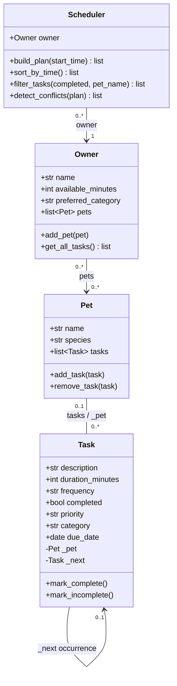

# PawPal+ (Module 2 Project)

**PawPal+** is a Streamlit app that helps pet owners plan care tasks across
multiple pets.

## Features

- **Multi-pet task management:** Add pets and create, edit, complete, reopen,
  or remove their care tasks.
- **Daily planning:** Schedule due, incomplete tasks by priority and preferred
  category within the available time, with an explanation for each choice.
- **Sorting by time:** View tasks from shortest to longest duration; this does
  not change the daily plan's priority-first order.
- **Filtering:** Narrow the task overview by pet name and completion status.
- **Conflict warnings:** Check supplied intervals for overlaps and invalid or
  incomparable times, and show scheduler warnings in the app.
- **Daily and weekly recurrence:** Completing a recurring task creates its
  next occurrence, due one or seven days after completion.

## Implementation summary

The multi-pet backend models each care activity as a `Task` with a duration,
frequency label, priority, and completion status. Each `Pet` holds its tasks,
while an `Owner` holds multiple pets and gathers their tasks through
`get_all_tasks()`. The `Scheduler` uses that combined list to plan incomplete
tasks within the owner's available time and explain its choices.

The terminal demo and Streamlit app both use this backend. In the app, add
pets, select a pet to add or edit its tasks, and generate a shared daily plan.

## Final UML design

The [final Mermaid source](diagrams/uml_final.mmd) describes the implemented
multi-pet backend. The [initial draft](diagrams/uml_draft.mmd) is also
available for comparison.



## Planning rules

Tasks are sorted by priority (high, medium, low), then by the owner's preferred
category within the same priority, preserving entry order for ties. The planner
greedily schedules tasks that fit within the available minutes and by
midnight, skipping tasks that do not fit and continuing to consider the rest.
Scheduled tasks are placed consecutively from the chosen start time; these
times are suggestions, not medication instructions or fixed appointments.
The app shows its reasoning and lists unscheduled tasks. Tasks and inputs live
in the Streamlit session and are not saved after that session ends.

Use Python 3.10 or later. Run the app with `streamlit run app.py` and the tests
with `pytest`.

## Multi-pet backend

`pawpal_system.py` contains the multi-pet implementation: an `Owner`
holds pets, each `Pet` holds tasks, and `Owner.get_all_tasks()` returns
`(pet, task)` pairs for the `Scheduler`. The scheduler considers incomplete
tasks across all pets, using the same priority, preference, time-budget, and
midnight rules described above. It returns each pet and task with suggested
start/end times and a reason; tasks that do not fit have `None` for both times.

The Streamlit app stores the owner and its pets and tasks in session state.
Tasks can be marked complete when edited; completed tasks are excluded from
plans. The due date is visible and editable for each task. The task overview
filters by pet name and completion status and displays results by duration;
these display filters do not change the daily plan.

## Smarter Scheduling

- **Sorting — `Scheduler.sort_by_time()`:** Returns all `(pet, task)` pairs,
  including completed tasks, from shortest to longest duration. This does not
  change the priority-first ordering used by `Scheduler.build_plan()`.
- **Filtering — `Scheduler.filter_tasks()`:** Filters pet-task pairs by
  completion status, pet name, or both. Names are trimmed and matched exactly
  without regard to case; duplicate names match all corresponding pets.
- **Conflict detection — `Scheduler.detect_conflicts()`:** Returns warnings
  for overlapping intervals across the same or different pets, and for
  invalid or incomparable intervals. Adjacent intervals are not conflicts and
  unscheduled entries are ignored. The app displays warnings above the plan
  for the owner to review. Generated plans are consecutive, so the method is
  also useful for checking supplied intervals.
- **Recurring tasks — `Task.mark_complete()` and `Task.mark_incomplete()`:**
  Completing a daily or weekly task creates an incomplete occurrence due one
  or seven days after completion. Frequency matching is case-insensitive; other
  labels do not recur automatically. Reopening removes the next occurrence
  only if it is unchanged and incomplete. `Scheduler.build_plan()` excludes
  future occurrences until they are due.

Task time is a duration in minutes; tasks do not have fixed start times.
Suggested times are not medication instructions or fixed appointments; follow
veterinary advice for time-sensitive care.

Run `python main.py` for a terminal demonstration of the multi-pet scheduler.

## Demo Walkthrough

After completing setup, start the app with `streamlit run app.py`:

1. Enter your name, available minutes, preferred category, and a start time
   under **Owner and planning preferences**.
2. Under **Pets**, enter a pet's name and species and select **Add pet**.
3. Under **Care tasks**, select the pet and add a task with its category,
   duration, frequency, due date, and priority. Select an existing task to
   edit or remove it, or mark it complete and save the change.
4. Use **Task overview** to filter by pet name or completion status. Tasks
   appear shortest-duration first; the filters do not affect the daily plan.
5. Select **Generate schedule** under **Daily plan**. The app shows suggested
   times and reasons for scheduled tasks, plus tasks that did not fit. It
   displays any scheduler warnings above the plan.

Daily and weekly tasks create a new occurrence when completed. The next
occurrence is excluded from a plan until it is due. Generated plans place
tasks consecutively, so they do not normally overlap; conflict detection also
supports checking separately supplied intervals. Task times are durations,
not fixed appointments, and data lasts only for the current Streamlit session.

For a terminal demonstration, run `python main.py`. Its sample output below
includes a deliberately overlapping pair of intervals to demonstrate a
conflict warning:

```text
Tasks sorted by duration (including completed tasks)
5 min | Luna: Grooming
10 min | Mochi: Breakfast
15 min | Luna: Playtime
25 min | Mochi: Morning walk

Incomplete tasks for Luna
Luna: Playtime

Completed tasks
Luna: Grooming

Today's Schedule
09:00-09:25 | Mochi: Morning walk (25 min)
  High priority; matches your preferred category; fits in the remaining 60 minutes.
09:25-09:35 | Mochi: Breakfast (10 min)
  High priority; fits in the remaining 35 minutes.
09:35-09:50 | Luna: Playtime (15 min)
  Medium priority; fits in the remaining 25 minutes.

Conflict detection example (manually overlapping times)
Warning: Schedule conflict: Mochi: Morning walk overlaps Luna: Playtime.
```

## Testing PawPal+

Run the test suite from the project directory:

```bash
python -m pytest
```

The tests cover task completion and addition, multi-pet scheduling, sorting,
filtering, recurrence, conflict warnings, input validation, and Streamlit
interactions. A successful run produced:

```text
============================= test session starts ==============================
platform darwin -- Python 3.14.3, pytest-9.2.0, pluggy-1.7.0
rootdir: /Users/imanimusembi/ai110-module2show-pawpal-starter
plugins: anyio-4.16.0
collected 50 items

test_app.py ........                                                     [ 16%]
test_pawpal.py ..............                                            [ 44%]
test_pawpal_system.py .......................                            [ 90%]
tests/test_pawpal.py .....                                               [100%]

============================== 50 passed in 1.59s ==============================
```

**Confidence level: ★★★★☆ (4/5).** The tests exercise core behaviors and
important edge cases, but cannot prove the system is free of bugs. Session
data is not persistent, and fixed-time care is not automatically scheduled.

## Getting started

### Setup

```bash
python -m venv .venv
source .venv/bin/activate  # Windows: .venv\Scripts\activate
pip install -r requirements.txt
```

Start the app with `streamlit run app.py`.
